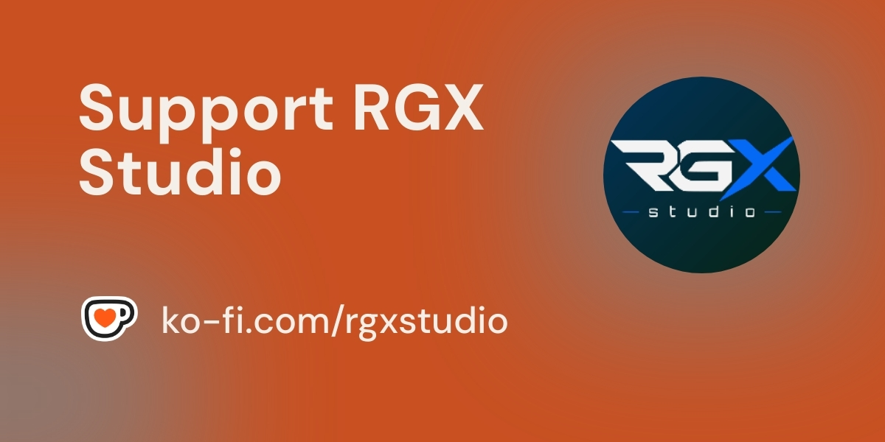
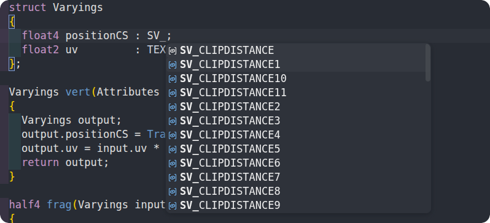
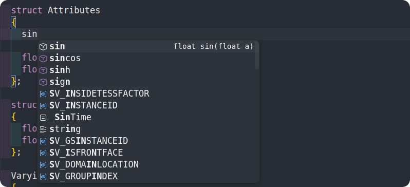
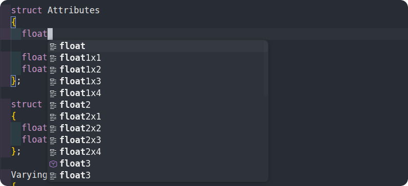
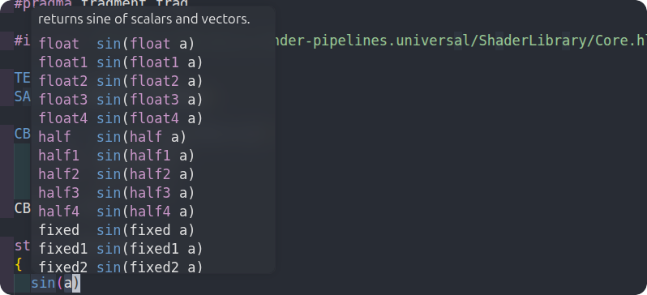
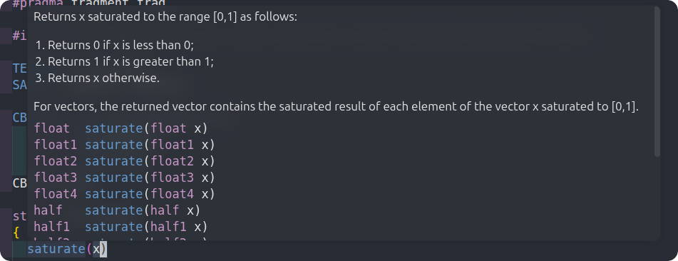
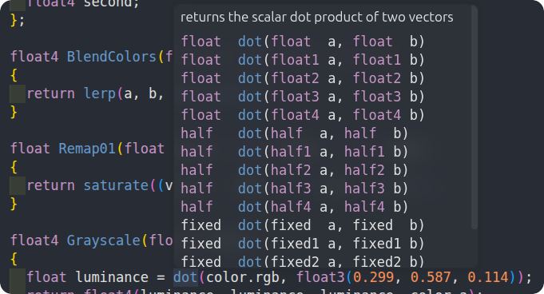
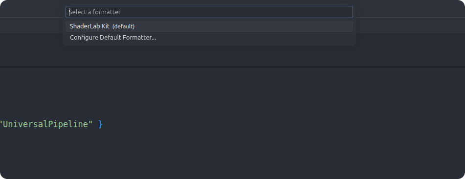
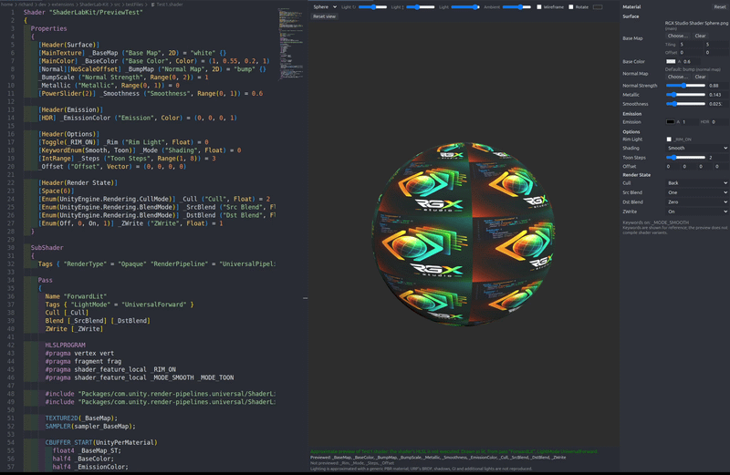

<div align="center">

# ShaderLab Kit

**HLSL / URP tooling for Unity shaders in VS Code.**


Completion · Hover docs · Diagnostics · Formatting · Go-to-definition · Snippets

</div>

<p align="center">
  <a href="https://ko-fi.com/rgxstudio">
    
  </a>
</p>

---

ShaderLab Kit adds real IntelliSense to Unity's `.shader`, `.hlsl`, `.cginc`, and `.compute` files — on top of VS Code's built-in syntax highlighting, not instead of it.

## Features

- 🎨 **Syntax highlighting** for Unity/URP macros and functions (`UNITY_MATRIX_*`, `TEXTURE2D`/`SAMPLE_TEXTURE2D`, `GetMainLight()`, and more) that VS Code's default HLSL/ShaderLab grammars don't recognize.
- 🧹 **Formatting** — consistent bracing, indentation, `Tags {}` collapsing, and preprocessor-aware indentation.
- ⚡ **Smart completion** — HLSL intrinsics with full argument snippets (`lerp(${a}, ${b}, ${w})`), HLSL semantics (`POSITION`, `TEXCOORD0`, `SV_Target`), Unity/URP globals (`_Time`, `_MainTex_ST`, `GetMainLight()`), `Blend`/`ZWrite`/`ZTest`/`Cull` values, ShaderLab property types, and `#include` path completion.
- 📖 **Hover documentation** — real explanations for HLSL semantics and Unity/URP globals, not just a type label.
- 🧠 **Shader-aware symbols** — completion, hover and go-to-definition for what *your* shader declares: material properties (`_Color1`), keywords (including the `_CHANNELS_6_CHANNELS` family a `[KeywordEnum]` generates), `#define` macros, functions (with `//` / `/** */` doc comments), structs and `IN.`/`OUT.` members — across the file and its project-local `#include`s.
- 🧾 **ShaderLab syntax help** — `[Toggle]`/`[KeywordEnum]`/`[HDR]`… property attributes, `Tags` keys and values (`LightMode`, `Queue`, `RenderType`), `ColorMask`/`BlendOp`/`Stencil`/`Offset` and other statements, `FallBack`/`CustomEditor`, and every `#pragma` form (`shader_feature_local`, `multi_compile_fragment`, `target`, `only_renderers`, …) with explanations of when to use which.
- 🔦 **URP library coverage** — ~190 curated entries: `TransformObjectToWorldNormal`, `GetVertexPositionInputs`, `SampleSH`, `ApplyShadowBias`, `LIGHT_LOOP_BEGIN`, `CBUFFER_START`, instancing/stereo macros, `UNITY_REVERSED_Z`, math constants, URP shader keywords (`_MAIN_LIGHT_SHADOWS`, `_SHADOWS_SOFT`, …) and `Light`/`InputData`/`VertexPositionInputs` members.
- 🔗 **Go-to-definition** — jump straight to an `#include`d file or a `Fallback` shader.
- 📁 **Unity-aware `#include` resolution** — understands Unity project layout and Package Manager paths (`Packages/...`, `Library/PackageCache/...`), with Unity Editor auto-detection.
- ⚠️ **Diagnostics** — unbalanced brackets, misspelled Unity/URP macros ("did you mean `GetMainLight`?"), wrong argument counts for HLSL intrinsics, and keyword bookkeeping: a `[Toggle]`/`[KeywordEnum]` that no `#pragma` declares, a material-driven keyword that should be `_local`, and typos in `#if defined(_KEYWORD)`.
- 🧪 **Shader preview** *(experimental)* — a 3D view beside your `.shader` file with an Inspector-style material editor generated from `Properties { }`. Sliders, color pickers with `[HDR]`, toggles, keyword enums and texture slots update the view live. It previews the *material* with your values using a stand-in material; it doesn't run your shader's HLSL. See [Shader preview](#shader-preview-experimental) for exactly what it can and can't do.
- ✂️ **Snippets** — a full URP shader template, `Pass` blocks, ShadowCaster and DepthOnly passes, a shared `UnityPerMaterial` `CBUFFER`, structs, vertex-transform boilerplate, keyword pragmas, include guards, and ShaderLab property declarations (including `[Toggle]`, `[KeywordEnum]`, `[HDR]`).

**Not supported:** Unity's legacy Cg pipeline (`CGPROGRAM`/`UnityCG.cginc`/surface shaders). ShaderLab Kit targets `HLSLPROGRAM` and the Universal Render Pipeline (URP).

## Screenshots

### Completion

HLSL semantics, intrinsics with their signatures, and every scalar, vector and matrix type.







### Hover documentation

What an intrinsic does, plus every overload.







### Formatting

ShaderLab Kit registers as the formatter for shader files.



## Shader preview (experimental)

> 🧪 **Experimental.** The preview is an early version. Behaviour, settings and stored values may change between releases, and it has rough edges. Please [report issues](../../issues).

Open a `.shader` file and click the preview button in the editor title bar, or run **ShaderLab Kit: Open Shader Preview (Experimental)**. A 3D view opens beside the editor with an Inspector-style material editor.



**Important: the preview does not run your shader's HLSL.** Unity shaders depend on Unity's include library and compiler, which can't run inside VS Code. Instead the preview draws a stand-in material driven by your shader's properties. It shows how the *material* looks with your values, not what your shader *code* computes. A banner under the view says which properties are previewed and which aren't.

### What it can do

- **Inspector built from `Properties { }`**:
  - Number fields for Float and Int.
  - Sliders for Range, including `[PowerSlider]` and `[IntRange]`.
  - Color pickers with alpha and `[HDR]` intensity.
  - Vector fields.
  - Checkboxes for `[Toggle]`, `[ToggleOff]` and `[ToggleUI]`.
  - Dropdowns for `[KeywordEnum]` and `[Enum]`, including `UnityEngine.Rendering.CullMode`/`BlendMode`/`CompareFunction`.
  - 2D texture slots with tiling and offset.
  - Layout from `[Header]`, `[Space]` and `[HideInInspector]`.
- **Two looks**, picked automatically:
  - **Unlit**: base color × base map.
  - **Lit**, for shaders that include URP's `Lighting.hlsl`, call `GetMainLight()`/`UniversalFragmentPBR()`, or declare `_Metallic`/`_Smoothness`: a generic PBR material with base color/map, normal map, metallic, smoothness and emission.
- **Property recognition** by attribute (`[MainTexture]`, `[MainColor]`, `[Normal]`) or by URP's usual names (`_BaseMap`/`_MainTex`, `_BaseColor`/`_Color`, `_BumpMap`, `_Metallic`, `_Smoothness`, `_EmissionColor`, `_Cutoff`).
- **Render state** from the drawn pass: `Cull`, `ZWrite`, `ZTest`, `Blend`, `ColorMask 0` and alpha clip. This includes `[_Property]` references such as `Cull [_Cull]`.
- **Pass selection**: the first `UniversalForward` / `UniversalForwardOnly` / `SRPDefaultUnlit` / untagged pass of the first URP-compatible SubShader. ShadowCaster, DepthOnly, Meta and similar passes are skipped.
- **Scene controls**: sphere, cube, plane, cylinder or torus; orbit camera; light direction and intensity; ambient; background color; wireframe; turntable rotation.
- **Live updates**: refreshes as you type (`shaderlabKit.preview.refreshDelay`) and immediately on save, and follows the active `.shader` editor.
- **Remembered values**: kept per shader in VS Code's workspace state, never written to your project. **Reset** restores the shader's declared defaults.
- **Keywords**: shows which ones the current `[Toggle]`/`[KeywordEnum]` values enable.

### What it can't do (yet)

- **Run your shader's code**: custom vertex or fragment logic, `_Time` animation, vertex displacement, scrolling UVs, depth effects (foam, soft particles) and so on. Shader-driven movement isn't shown.
- **Compile keyword variants.** Toggles and keyword enums show their keywords but don't change what is drawn.
- **Evaluate `#include`s**, render multiple passes, or resolve `UsePass`/`GrabPass`.
- **Cube and 3D textures.** They appear in the inspector but aren't drawn.
- **Shadows, GI, reflection probes, fog or additional lights.**
- **Custom meshes.**
- **Unity `.mat` files**: no reading or writing.
- **`BlendOp` and `Stencil`.**
- **Some texture formats.** Files must be PNG, JPEG, WebP, GIF or BMP, up to 32 MB; TGA, PSD and EXR aren't supported.
- **Legacy shaders.** `CGPROGRAM`/surface shaders are out of scope, and HDRP-only SubShaders aren't drawn.

For exact results, check your shader in Unity. Next on the roadmap: running a restricted subset of shader HLSL, then an optional Unity Editor bridge.

## Requirements

- VS Code `1.85.0` or later.
- No Unity installation required — but `#include` resolution and Unity Editor path detection work best inside an actual Unity project.

## Installation

Install from the VS Code Extensions view — search for **ShaderLab Kit** — or via the command line:

```bash
code --install-extension rgx-studio.shaderlab-kit
```

Or get it directly from the [Marketplace](https://marketplace.visualstudio.com/items?itemName=rgx-studio.shaderlab-kit).

## Configuration

All settings live under **ShaderLab Kit** in VS Code's Settings UI (`shaderlabKit.*`):

| Setting | Default | Description |
|---|---|---|
| `shaderlabKit.suggest.enable` | `true` | Enable completion and hover. |
| `shaderlabKit.analysis.enable` | `true` | Enable diagnostics. |
| `shaderlabKit.analysis.maxVariantsWarning` | `256` | Variant-count warning threshold *(reserved for an upcoming analysis feature)*. |
| `shaderlabKit.analysis.maxVariantsError` | `512` | Variant-count error threshold *(reserved for an upcoming analysis feature)*. |
| `shaderlabKit.formatting.enable` | `true` | Enable the formatter. |
| `shaderlabKit.formatting.bracestyle` | `true` | Reflow braces to Allman style. |
| `shaderlabKit.formatting.tags.singleline` | `true` | Collapse `Tags { ... }` blocks to one line. |
| `shaderlabKit.formatting.cbuffer` | `true` | Indent `CBUFFER_START(...)`/`CBUFFER_END` contents. |
| `shaderlabKit.formatting.preprocessorStyle` | `"Hierarchy"` | How `#directive` lines and code inside `#if` blocks indent: `Hierarchy`, `Follow Code`, `Flush Left`, `None`. |
| `shaderlabKit.formatting.indentIncludeGuard` | `false` | Count a header include guard (`#ifndef X` + `#define X`) as an indent level. |
| `shaderlabKit.include.enable` | `true` | Enable `#include` resolution. |
| `shaderlabKit.include.customPaths` | `[]` | Extra search paths for resolving `#include`. |
| `shaderlabKit.include.unityEditorPathOverride` | `""` | Manual Unity Editor path, for when auto-detection fails. |
| `shaderlabKit.preview.refreshDelay` | `400` | *(Experimental preview)* Milliseconds after the last edit before the shader preview refreshes (saving refreshes immediately). |

## Roadmap

- Semantic shader-variant analysis (`multi_compile`/`shader_feature` combination counting).
- A symbol cache for faster, indexed go-to-definition on large projects.
- Selection-aware range formatting (today, formatting a selection reformats the whole file).
- Shader preview (experimental today): run a restricted subset of shader HLSL (unlit and simple-lit), `_Time`, Cube textures and custom meshes; later `.mat` import/export and an optional Unity Editor bridge.

---

## For Developers

### Development Setup

```bash
git clone https://github.com/RichardCG75/shaderlab-kit
cd shaderlab-kit
npm install
```

In VS Code:

1. Install the **esbuild Problem Matchers** extension (`connor4312.esbuild-problem-matchers`) — required for the build task's problem matcher.
2. Press **F5** (or Run and Debug → "Run Extension") to build and launch an **Extension Development Host** window. Open a `.shader`/`.hlsl` file *in that new window*.
3. Confirm the file's language mode (bottom-right corner) is **ShaderLab** or **HLSL** — VS Code occasionally mis-detects `.shader` as C++.

| Script | Purpose |
|---|---|
| `npm run watch` | Rebuild on save |
| `npm run check-types` | TypeScript check, no emit |
| `npm run lint` | ESLint over `src/` |
| `npm run package` | Production build (type-check + lint + minify) |

ShaderLab Kit runs entirely in-process (no language server) and layers its grammar on top of VS Code's built-in `shaderlab`/`hlsl` languages rather than replacing them, so it stays compatible with other extensions and themes targeting the same scopes.

### Contributing

1. Fork the repo and create a branch for your change.
2. Before opening a PR, run:
   ```bash
   npm run check-types
   npm run lint
   ```
3. Open a pull request describing what changed and why. Small, focused PRs are easiest to review.
4. For a new feature, a scope change, or anything architectural, open an [Issue](../../issues) or [Discussion](../../discussions) first so we can align on direction.

**Contact:**

- [GitHub Issues](../../issues) — bugs, concrete feature requests.
- [GitHub Discussions](../../discussions) — open-ended ideas and questions.
- Email: <ricardo.chacon@rgxstudio.dev>

## License

MIT — see [`LICENSE`](./LICENSE).
