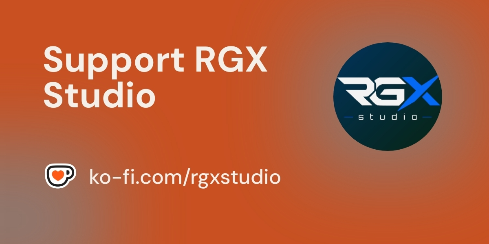

<div align="center">

# ShaderLab Kit

**HLSL / URP tooling for Unity shaders in VS Code.**


Completion · Hover docs · Diagnostics · Formatting · Go-to-definition · Snippets

</div>

<p align="center">
  <a href="https://ko-fi.com/rgxstudio">
    
  </a>
</p>

---

ShaderLab Kit adds real IntelliSense to Unity's `.shader`, `.hlsl`, `.cginc`, and `.compute` files — on top of VS Code's built-in syntax highlighting, not instead of it.

## Features

- 🎨 **Syntax highlighting** for Unity/URP macros and functions (`UNITY_MATRIX_*`, `TEXTURE2D`/`SAMPLE_TEXTURE2D`, `GetMainLight()`, and more) that VS Code's default HLSL/ShaderLab grammars don't recognize.
- 🧹 **Formatting** — consistent bracing, indentation, `Tags {}` collapsing, and preprocessor-aware indentation.
- ⚡ **Smart completion** — HLSL intrinsics with full argument snippets (`lerp(${a}, ${b}, ${w})`), HLSL semantics (`POSITION`, `TEXCOORD0`, `SV_Target`), Unity/URP globals (`_Time`, `_MainTex_ST`, `GetMainLight()`), `Blend`/`ZWrite`/`ZTest`/`Cull` values, ShaderLab property types, and `#include` path completion.
- 📖 **Hover documentation** — real explanations for HLSL semantics and Unity/URP globals, not just a type label.
- 🔗 **Go-to-definition** — jump straight to an `#include`d file or a `Fallback` shader.
- 📁 **Unity-aware `#include` resolution** — understands Unity project layout and Package Manager paths (`Packages/...`, `Library/PackageCache/...`), with Unity Editor auto-detection.
- ⚠️ **Diagnostics** — unbalanced brackets, misspelled Unity/URP macros ("did you mean `GetMainLight`?"), and wrong argument counts for HLSL intrinsics.
- ✂️ **Snippets** — a full URP shader template, `Pass` blocks, structs, vertex-transform boilerplate, and ShaderLab property declarations.

**Not supported:** Unity's legacy Cg pipeline (`CGPROGRAM`/`UnityCG.cginc`/surface shaders). ShaderLab Kit targets `HLSLPROGRAM` and the Universal Render Pipeline (URP).

## Requirements

- VS Code `1.140.0` or later.
- No Unity installation required — but `#include` resolution and Unity Editor path detection work best inside an actual Unity project.

## Installation

Install from the VS Code Extensions view — search for **ShaderLab Kit** — or via the command line:

```bash
code --install-extension rgx-studio.shaderlab-kit
```

Or get it directly from the [Marketplace](https://marketplace.visualstudio.com/items?itemName=rgx-studio.shaderlab-kit).

## Configuration

All settings live under **ShaderLab Kit** in VS Code's Settings UI (`shaderlabKit.*`):

| Setting | Default | Description |
|---|---|---|
| `shaderlabKit.suggest.enable` | `true` | Enable completion and hover. |
| `shaderlabKit.analysis.enable` | `true` | Enable diagnostics. |
| `shaderlabKit.analysis.maxVariantsWarning` | `256` | Variant-count warning threshold *(reserved for an upcoming analysis feature)*. |
| `shaderlabKit.analysis.maxVariantsError` | `512` | Variant-count error threshold *(reserved for an upcoming analysis feature)*. |
| `shaderlabKit.formatting.enable` | `true` | Enable the formatter. |
| `shaderlabKit.formatting.bracestyle` | `true` | Reflow braces to Allman style. |
| `shaderlabKit.formatting.tags.singleline` | `true` | Collapse `Tags { ... }` blocks to one line. |
| `shaderlabKit.formatting.cbuffer` | `true` | Indent `CBUFFER_START(...)`/`CBUFFER_END` contents. |
| `shaderlabKit.formatting.preprocessorStyle` | `"Hierarchy"` | How `#directive` lines and code inside `#if` blocks indent: `Hierarchy`, `Follow Code`, `Flush Left`, `None`. |
| `shaderlabKit.formatting.indentIncludeGuard` | `false` | Count a header include guard (`#ifndef X` + `#define X`) as an indent level. |
| `shaderlabKit.include.enable` | `true` | Enable `#include` resolution. |
| `shaderlabKit.include.customPaths` | `[]` | Extra search paths for resolving `#include`. |
| `shaderlabKit.include.unityEditorPathOverride` | `""` | Manual Unity Editor path, for when auto-detection fails. |

## Roadmap

- Semantic shader-variant analysis (`multi_compile`/`shader_feature` combination counting).
- A symbol cache for faster, indexed go-to-definition on large projects.
- Selection-aware range formatting (today, formatting a selection reformats the whole file).

---

## For Developers

### Development Setup

```bash
git clone https://github.com/RichardCG75/shaderlab-kit
cd shaderlab-kit
npm install
```

In VS Code:

1. Install the **esbuild Problem Matchers** extension (`connor4312.esbuild-problem-matchers`) — required for the build task's problem matcher.
2. Press **F5** (or Run and Debug → "Run Extension") to build and launch an **Extension Development Host** window. Open a `.shader`/`.hlsl` file *in that new window*.
3. Confirm the file's language mode (bottom-right corner) is **ShaderLab** or **HLSL** — VS Code occasionally mis-detects `.shader` as C++.

| Script | Purpose |
|---|---|
| `npm run watch` | Rebuild on save |
| `npm run check-types` | TypeScript check, no emit |
| `npm run lint` | ESLint over `src/` |
| `npm run package` | Production build (type-check + lint + minify) |

ShaderLab Kit runs entirely in-process (no language server) and layers its grammar on top of VS Code's built-in `shaderlab`/`hlsl` languages rather than replacing them, so it stays compatible with other extensions and themes targeting the same scopes.

### Contributing

1. Fork the repo and create a branch for your change.
2. Before opening a PR, run:
   ```bash
   npm run check-types
   npm run lint
   ```
3. Open a pull request describing what changed and why. Small, focused PRs are easiest to review.
4. For a new feature, a scope change, or anything architectural, open an [Issue](../../issues) or [Discussion](../../discussions) first so we can align on direction.

**Contact:**

- [GitHub Issues](../../issues) — bugs, concrete feature requests.
- [GitHub Discussions](../../discussions) — open-ended ideas and questions.
- Email: <ricardo.chacon@rgxstudio.dev>

## License

MIT — see [`LICENSE`](./LICENSE).
